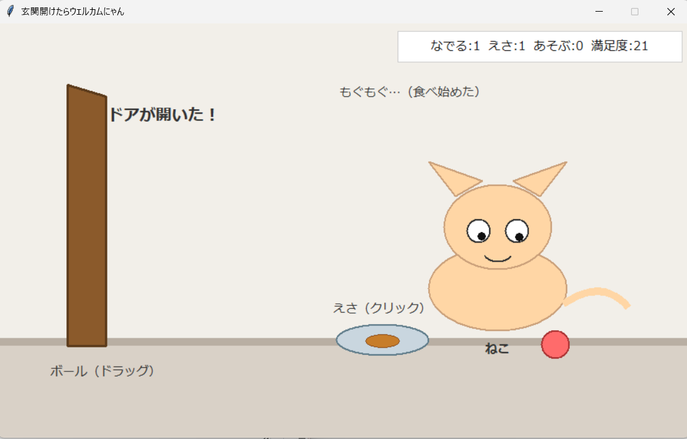

# welcome-nyan
Interactive cat game developed with Python and Tkinter.
# 玄関開けたらウェルカムにゃん

## Overview
PythonのTkinterを使用して制作した、猫とのコミュニケーションを楽しむインタラクティブゲーム。

玄関のドアを開けるところから始まり、猫をなでる・餌をあげる・ボールで遊ぶといった操作を通して猫との交流を体験できる。

## Features
- ドアをクリックして猫を登場させる
- 猫をクリックしてなでる
- 餌をあげる
- ボールをドラッグして猫と遊ぶ
- 操作に応じて猫の満足度やエンディングが変化する
- ボールの位置に合わせて猫の目線が動く

## Screenshot

## Technology
- Python
- Tkinter
- Canvas

## Implementation
マウスイベントによるクリック・ドラッグ処理、Canvasによる図形描画、状態管理、イベント処理を実装。

ユーザーの操作に応じてゲームの状態や猫の反応が変化する仕組みを制作した。
